# Hoja de vida web · Johan Cepeda

Sitio personal responsive que reúne mi hoja de vida, una página de contacto y la presentación del proyecto académico Help Me Tenerife. Su objetivo es mostrar mi perfil, experiencia, formación y trabajo web en una navegación sencilla.

**Sitio publicado:** [Hoja de vida web · Johan Cepeda](https://johancepeda92.github.io/Hoja_de_vida_Web_CepedaJohan/)

**Repositorio público:** [JohanCepeda92/Hoja_de_vida_Web_CepedaJohan](https://github.com/JohanCepeda92/Hoja_de_vida_Web_CepedaJohan) · Repositorio comprobado como público el 18 de octubre de 2026.

## Páginas

- [Hoja de vida — `index.html`](index.html)
- [Contacto — `contacto.html`](contacto.html)
- [Proyecto Help Me Tenerife — `help-me.html`](help-me.html)

## Mockups

Los siguientes PNG son diseños esquemáticos previos de las páginas. Representan su estructura con bloques grises, líneas y marcadores; no son capturas del sitio terminado.

### Hoja de vida

**Escritorio**

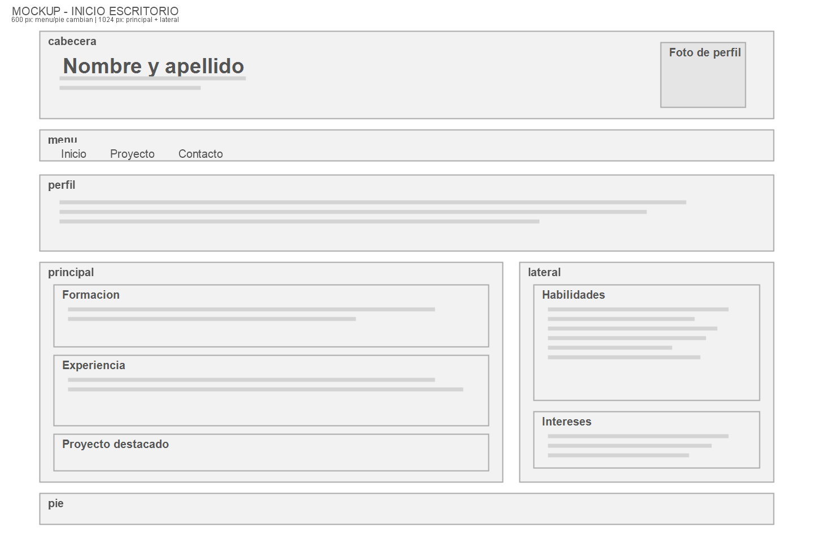

**Celular**

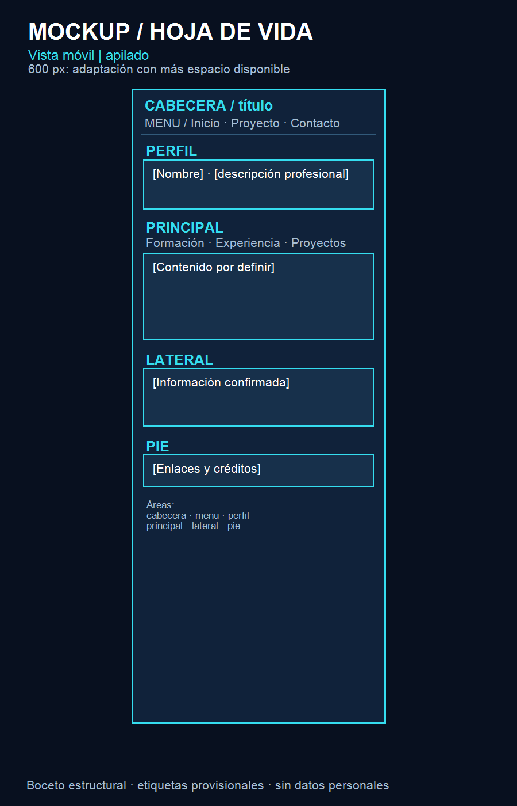

### Contacto

**Escritorio**

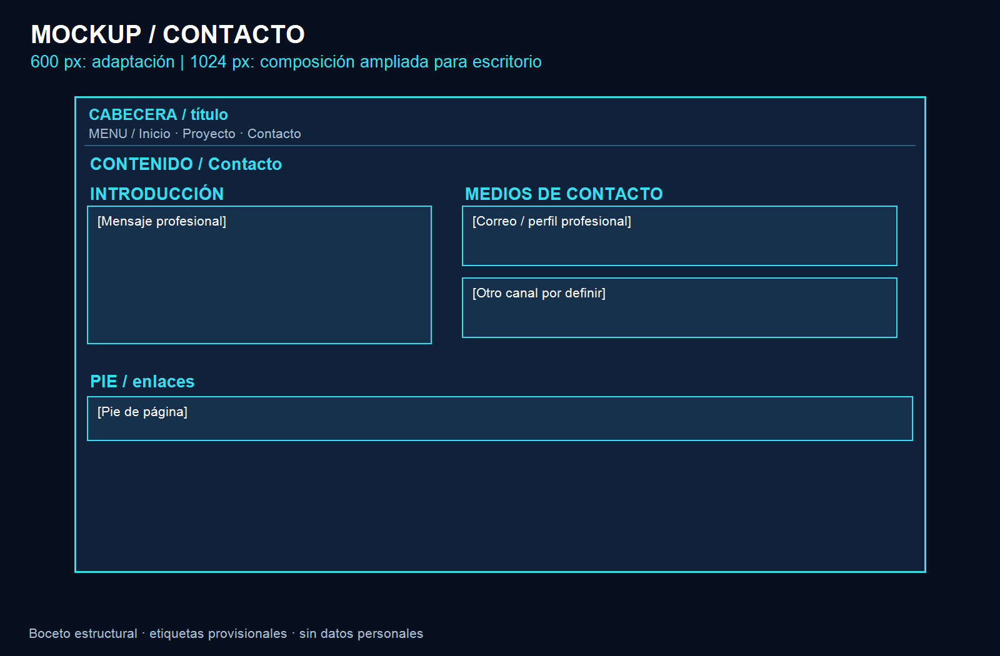

**Celular**

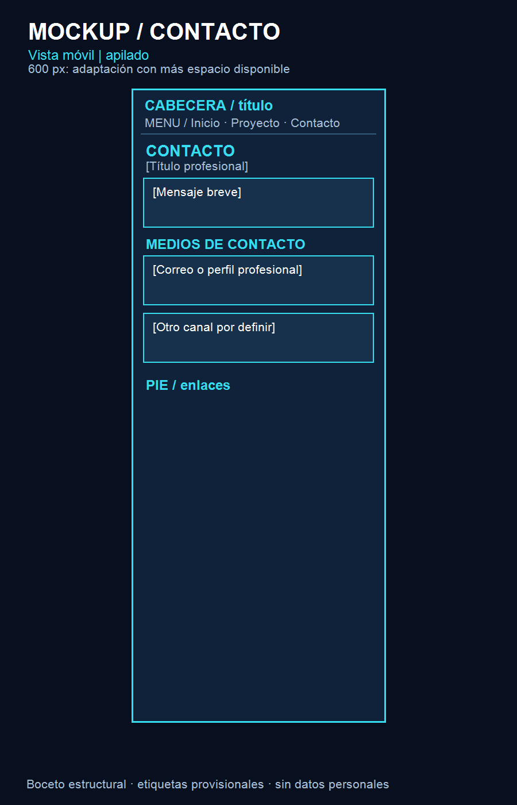

### Help Me Tenerife

**Escritorio**

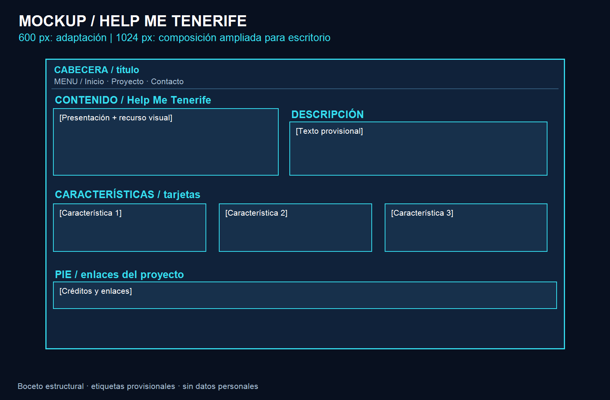

**Celular**

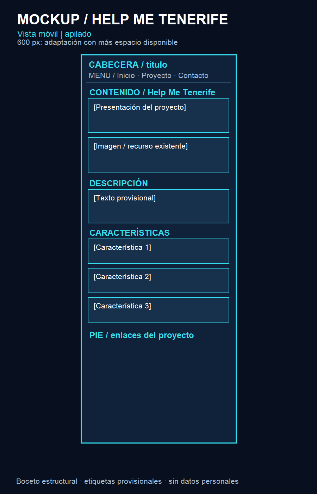

## Capturas del sitio publicado

Las capturas de escritorio corresponden al sitio publicado. Las capturas identificadas como celular real se tomaron durante pruebas en un dispositivo físico.

### Hoja de vida

**Computador**

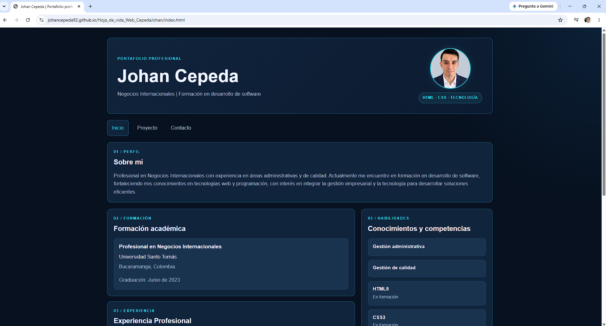

**Celular — dispositivo físico**

### Contacto

**Computador**

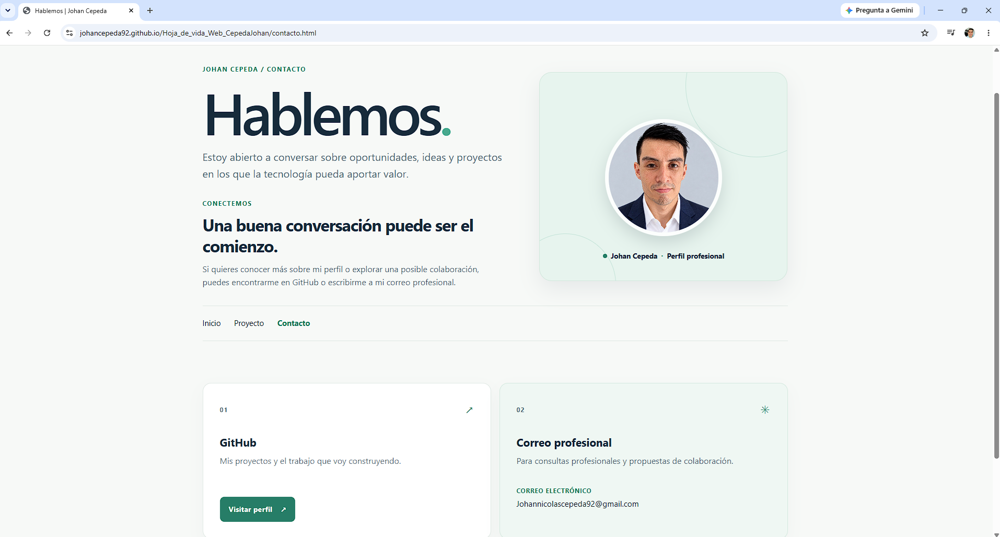

**Celular — dispositivo físico**

### Help Me Tenerife

**Computador**

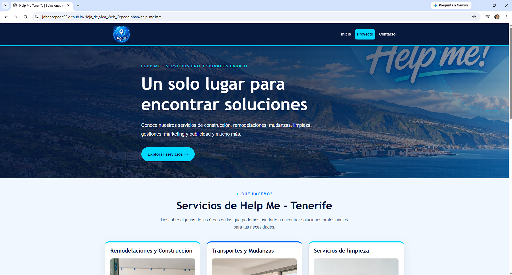

**Celular — dispositivo físico**

## Evidencias de validación HTML — W3C

Los tres archivos HTML del proyecto se comprobaron con el validador del W3C. En las capturas obtenidas, la validación finalizó sin errores ni advertencias.

### Hoja de vida — index.html

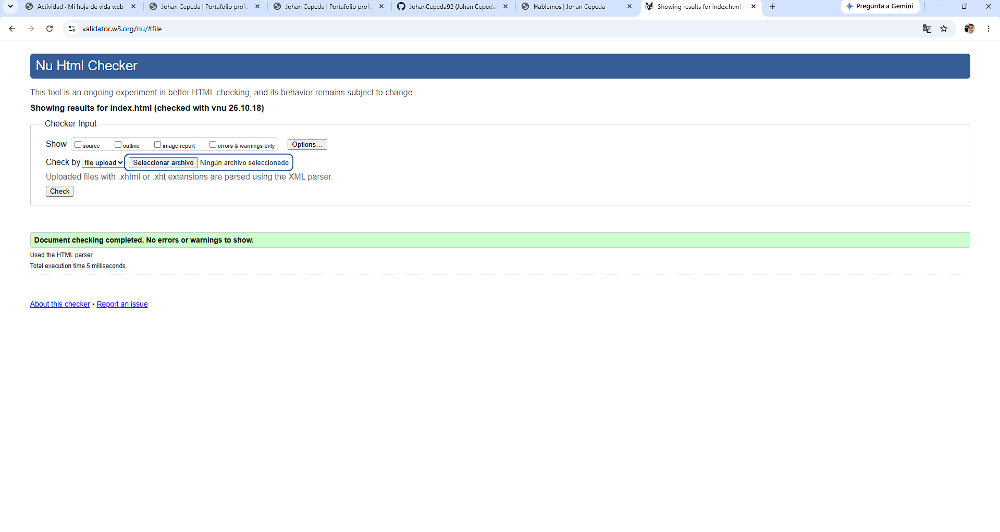

### Contacto — contacto.html

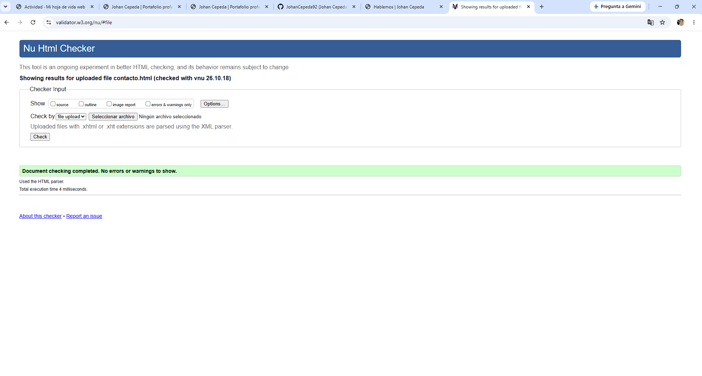

### Proyecto Help Me Tenerife — help-me.html

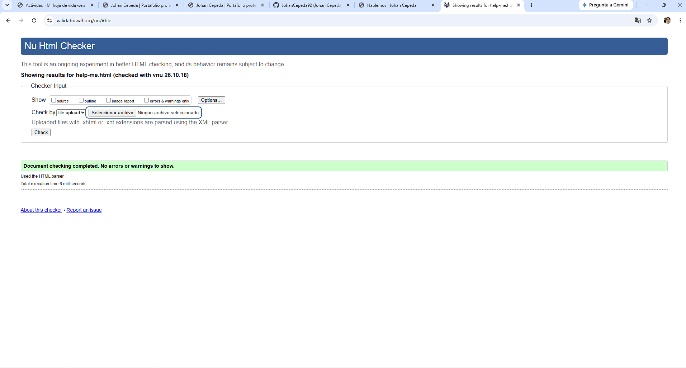

## Breakpoints
El CSS usa un enfoque mobile first: los estilos base se aplican desde pantallas estrechas y las media queries amplían la distribución en anchos mayores.

- **Ancho base (menos de 600 px):** la hoja de vida usa una columna y apila cabecera, navegación, perfil, contenido, barra lateral y pie. Contacto apila la presentación y las tarjetas. Los servicios de Help Me aparecen en una columna.
- **Desde 600 px:** la navegación de la hoja de vida se alinea a la izquierda y su pie pasa a una disposición horizontal. El contenido y la barra lateral pueden formar más columnas según el espacio disponible. Contacto coloca presentación y fotografía en dos columnas, y sus tarjetas lado a lado. Help Me distribuye los servicios en dos columnas.
- **Desde 801 px:** la cabecera de Help Me coloca el logotipo y la navegación en una fila.
- **Desde 1024 px:** la hoja de vida distribuye el contenido principal y la barra lateral en dos columnas. Help Me presenta sus tarjetas de servicios en tres columnas y fija su cabecera en la parte superior.

## Cómo lo publiqué

- **Repositorio:** proyecto público en GitHub: [JohanCepeda92/Hoja_de_vida_Web_CepedaJohan](https://github.com/JohanCepeda92/Hoja_de_vida_Web_CepedaJohan).
- **Subida de archivos:** los archivos del proyecto se subieron al repositorio mediante Git.
- **GitHub Pages:** se configuró la publicación desde la rama `main` y la carpeta raíz del repositorio.
- **Comprobación:** se revisó el sitio publicado en computador y celular; las capturas de celular corresponden a pruebas en un dispositivo físico.
## Fuentes consultadas

### Archivos del proyecto

- `index.html`, `contacto.html` y `help-me.html`: estructura y contenido de las páginas.
- `styles.css`: estilos y breakpoints implementados.
- Carpeta `mockups/`: nombres y rutas de los seis diseños esquemáticos.
- Repositorio público enlazado arriba: comprobación de visibilidad, rama principal y estado de GitHub Pages.

### Documentación externa

- [GitHub Docs: configurar una fuente de publicación para GitHub Pages](https://docs.github.com/en/pages/getting-started-with-github-pages/configuring-a-publishing-source-for-your-github-pages-site) — consultada como referencia para la configuración de GitHub Pages.

### Evidencias de validación W3C

- [Validación de `index.html`](evidencias/validaciones-w3c/index-w3c.png)
- [Validación de `contacto.html`](evidencias/validaciones-w3c/contacto-w3c.png)
- [Validación de `help-me.html`](evidencias/validaciones-w3c/help-me-w3c.png)

### Herramientas y tecnologías

- HTML5 y CSS3 para las páginas.
- Git y GitHub para el repositorio.
- GitHub Pages aloja la versión pública del sitio.